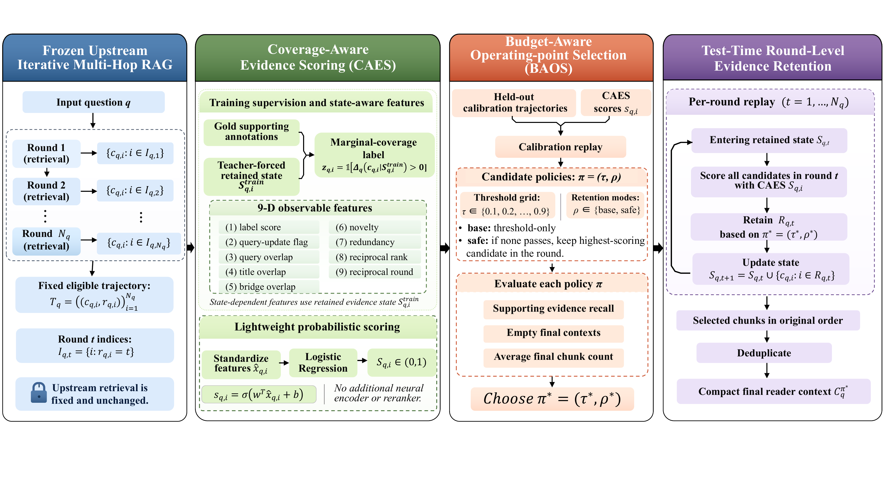

# CEBRA

### State-Aware Chunk Reduction for Efficient Context Construction in Multi-Hop RAG

CEBRA constructs compact reader contexts from fixed multi-hop retrieval trajectories. It scores a candidate using the evidence already retained, then applies a calibrated retention policy before downstream answer generation.

- **Coverage-Aware Evidence Scoring (CAES):** a nine-feature, class-balanced logistic-regression scorer estimates marginal supporting-evidence contribution.
- **Budget-Aware Operating-point Selection (BAOS):** held-out calibration balances evidence preservation and average context size against a budget-only reference.
- **Fixed retrieval, adaptive retention:** candidate retrieval and query updates stay unchanged; CEBRA controls which retrieved chunks enter the reader context.



*CEBRA framework from the manuscript. [View the original PDF](assets/framework-1.pdf).*

## Quick start

Use Python 3.11 in a fresh environment. The example below requires **no GPU, LLM weights, API key, or paid inference**.

```bash
git clone https://github.com/World-controller/CEBRA.git
cd CEBRA
python3.11 -m venv .venv
source .venv/bin/activate
python -m pip install -r requirements-cebra.txt

python src/cebra.py retain \
  --config configs/hotpotqa.json \
  --fpath examples/smoke/test.jsonl \
  --output outputs/smoke-retained.jsonl \
  --smoke-example

python src/cebra.py evaluate \
  --fpath outputs/smoke-retained.jsonl \
  --output outputs/smoke-metrics.json
```

This is a **synthetic smoke example**, not a benchmark or a claim to reproduce paper results. `--smoke-example` explicitly uses regex lexical features only on marked synthetic rows. The bundled scorer is unchanged, but these example features are not the formal NLP profile. Output metadata records that distinction. Existing output files are never overwritten; use a new destination when rerunning.

## Train, calibrate, retain, evaluate

The public interface is `python src/cebra.py <command> --help`.

| Command | Input | Output |
|---|---|---|
| `train` | Separate training trajectories with supporting-document IDs | CAES scorer and provenance sidecar |
| `calibrate` | Calibration-only trajectories, split manifest, trained scorer | BAOS candidate curve and locked operating point |
| `retain` | Retrieval trajectories and a frozen config or model + lock | Compatible JSONL with retention decisions |
| `evaluate` | Retained trajectories with supporting-document annotations | Recall, unique context size, duplicates, empty contexts and schema coverage |

For normal NLP features, first install the pinned language model:

```bash
python -m pip install -r requirements-nlp.txt
```

See **[the reproducibility guide](docs/reproducibility.md)** for full commands, split manifests, frozen configurations and the exact BAOS selection behavior. See **[the trajectory format](docs/trajectory-format.md)** for input/output fields. The original research entry points remain compatible.

### Frozen artifacts

| Evaluation dataset | Scorer training source | Threshold | Mode |
|---|---|---:|---|
| HotpotQA | 2WikiMultiHopQA training trajectories | 0.7 | base |
| 2WikiMultiHopQA | HotpotQA validation-derived trajectories | 0.2 | base |
| MuSiQue | Same HotpotQA transfer scorer | 0.1 | base |

The two small scorer files are copied unchanged and checked against recorded SHA-256 hashes. These are frozen operating points, not new fits or recalibration. `base` means no minimum-per-round fallback. The budget reference is `B=3`; **CEBRA is not a hard per-question top-3 selector**.

## Data and downstream readers

The quick start includes synthetic text only. Full experiments require separately prepared corpus data, split IDs and retrieval trajectories. Source datasets: [HotpotQA](https://hotpotqa.github.io/), [2WikiMultiHopQA](https://github.com/Alab-NII/2wikimultihop), and [MuSiQue](https://github.com/StonyBrookNLP/musique).

The [advanced guide](docs/advanced.md) covers trajectory generation, baseline evaluation and reader integration. The paper uses an 8B reader with CUDA and a 70B reader through hosted APIs. Those stages have separate hardware, model-access and service requirements; they are not part of the CPU smoke example. Full datasets, large model weights and complete historical experiment outputs are not bundled in this code release.

## Code map

- [`src/cebra.py`](src/cebra.py): public commands and validation.
- [`src/evaluation/cmrg_calibrated.py`](src/evaluation/cmrg_calibrated.py): CAES features, training and stateful retention.
- [`src/evaluation/run_four_configs.py`](src/evaluation/run_four_configs.py): budget-matched BAOS selection and streaming replay.
- [`configs/`](configs/): frozen dataset operating points.
- [`models/`](models/): trusted scorer artifacts and hash metadata.
- [`tests/`](tests/): command, parity, boundary and publication checks.

## Paper and citation

This repository accompanies **CEBRA: State-Aware Chunk Reduction for Efficient Context Construction in Multi-Hop RAG**. Bibliographic metadata and a paper link will be added when available; no publication venue, acceptance status or DOI is asserted here. For now, reference this repository URL and the exact commit you use.

## License and third-party components

Code is distributed under the [MIT license](LICENSE). Existing copyright and license notices are preserved. See [third-party acknowledgments](docs/third-party.md) and [NOTICE](NOTICE) for source attribution and model-license requirements. Model and dataset terms apply separately.

Built with Meta Llama 3.
